# SCP: Secret Laboratory IL2CPP Dumper 逆向实现报告

## 结论摘要

已在 `G:\SCP_SL-Dumper` 中实现并验证一个基于 Frida 的 IL2CPP
运行时 Dumper。它通过 `GameAssembly.dll` 导出的 IL2CPP API 枚举运行时
程序集、类型和成员，最终生成 `output\dump.cs`。

本次验证产物：

| 项目 | 结果 |
| --- | --- |
| 程序集/镜像 | 80 |
| 运行时类型 | 16,282 |
| 字段和枚举成员 | 72,694 |
| 方法 | 97,641 |
| `dump.cs` 大小 | 23,653,817 字节 |
| `dump.cs` SHA256 | `B5327E408E62DA0DACA3AADDC78A2568B89BCB01F16D7708DED5D8A2C35BE71A` |

## 范围

- 范围契约：[scope.md](scope.md)
- 目标客户端：用户指定的本机安装目录
- 操作类型：本地文件分析、临时进程运行时枚举、生成转储文件
- 未执行：远程服务访问、网络扫描、客户端二进制修改

## 实现结构

| 文件 | 职责 |
| --- | --- |
| `dump.ps1` | 校验路径和依赖，组织命令行参数，启动 Python 驱动 |
| `runtime_dumper.py` | Frida spawn/attach、消息接收、原子写入、旧文件备份和进程清理 |
| `runtime_dumper.js` | 调用 IL2CPP 导出 API，生成 C# 风格的类型和成员描述 |
| `output\dump.cs` | 最终运行时转储结果 |

详细流程图见：[flowchart.md](flowchart.md)。

```mermaid
flowchart LR
    start["运行 dump.ps1"] --> check["检查游戏、Python 和 Frida"]
    check --> spawn["Frida 启动临时 SCPSL.exe"]
    spawn --> wait["等待 IL2CPP 初始化"]
    wait --> api["调用 GameAssembly IL2CPP 导出 API"]
    api --> enumerate["枚举程序集、类型、字段、属性和方法"]
    enumerate --> stream["分块传输到 Python"]
    stream --> temp["写入临时 dump 文件"]
    temp --> valid{"输出有效?"}
    valid -- 否 --> cleanup["删除临时文件并终止临时进程"]
    valid -- 是 --> backup["备份旧 dump.cs"]
    backup --> replace["原子替换 output/dump.cs"]
    replace --> cleanup
```



## Evidence → Finding → Path

### Evidence

#### E-001：目标文件指纹

- source_type: file
- source_ref: 本机客户端 `GameAssembly.dll` 与 `global-metadata.dat`
- `GameAssembly.dll` SHA256：`0CF429625B379548101ACC6B7C3F40AFB363894B84A505E503D9DD5372E04BCF`
- `global-metadata.dat` SHA256：`C47ABD3E1730826E83638D42B0BF25B7F5CE1E8BFC7A07F360E3C72D1FC68E2D`
- repro_command:

```powershell
Get-FileHash -Algorithm SHA256 `
  'C:\SteamLibrary\steamapps\common\SCP Secret Laboratory\GameAssembly.dll', `
  'C:\SteamLibrary\steamapps\common\SCP Secret Laboratory\SCPSL_Data\il2cpp_data\Metadata\global-metadata.dat'
```

#### E-002：运行时枚举成功

- source_type: command/log
- source_ref: `powershell -File .\dump.ps1`
- raw_excerpt: `images=80, classes=16282, fields=72694, methods=97641`
- repro_command:

```powershell
cd G:\SCP_SL-Dumper
powershell -NoProfile -ExecutionPolicy Bypass -File .\src\launcher\dump.ps1
```

#### E-003：最终转储产物

- source_type: file
- source_ref: `output\dump.cs`
- content_hash: `B5327E408E62DA0DACA3AADDC78A2568B89BCB01F16D7708DED5D8A2C35BE71A`
- raw_excerpt: `// Images: 80; Runtime classes: 16282`
- repro_command:

```powershell
Get-Item G:\SCP_SL-Dumper\output\dump.cs
Get-FileHash -Algorithm SHA256 G:\SCP_SL-Dumper\output\dump.cs
```

### Finding

#### F-001：运行时 API 路线可生成完整的类型定位资料

- severity: n/a_re
- category: reverse_algo
- status: validated
- evidence_ids: [E-001, E-002, E-003]
- location: `runtime_dumper.js: rpc.exports.dump`
- impact: 可在客户端更新后重新生成与当前版本匹配的类型、字段偏移、方法
  Token 和 RVA 信息，不依赖静态注册表定位成功。
- confidence: high
- remediation: n/a

### Path

#### P-001：IL2CPP 运行时转储调用路径

- path_type: callflow
- start: `dump.ps1`
- goal: `output\dump.cs`
- steps:
  1. 校验客户端、Python、Frida 和脚本路径 — evidence: E-001
  2. 使用 Frida spawn 创建临时客户端并等待 IL2CPP 初始化 — evidence: E-002
  3. 从 IL2CPP domain 枚举 assembly/image/class — evidence: E-002
  4. 枚举字段、枚举常量、属性、方法、Token 和方法指针 — evidence: E-002
  5. 分块传输并原子写入 `dump.cs` — evidence: E-003
- residual_risks: 游戏升级可能改变导出 API 或 `MethodInfo` 布局，升级后应重新运行验证。

## 验证结果

1. `runtime_dumper.py` 已通过 `python -m py_compile`。
2. `runtime_dumper.js` 已通过 `node --check`。
3. Dumper 已成功端到端运行两次。
4. 枚举类型总数与进度终值一致：`16282/16282`。
5. 抽样枚举 `ReproProjectAssetType` 成功恢复 `Wildcard=0`、`Scene=1`、
   `Prefab=2`、`Asset=3`。
6. 抽样类型 `ReferenceHub` 包含继承关系、字段偏移、属性和方法信息。
7. 所有抽样方法 RVA 均位于 `GameAssembly.dll` 映射范围内。
8. Dumper 创建的临时 `SCPSL.exe` 已终止，没有遗留临时输出文件。

## 使用命令

```powershell
cd G:\SCP_SL-Dumper
powershell -NoProfile -ExecutionPolicy Bypass -File .\src\launcher\dump.ps1
```

完整的使用说明见：[README.md](../README.md)。
